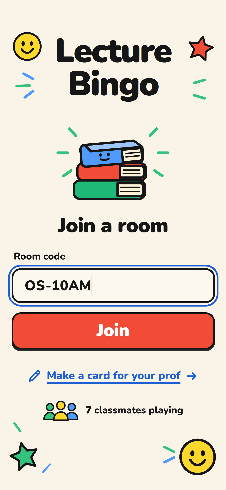
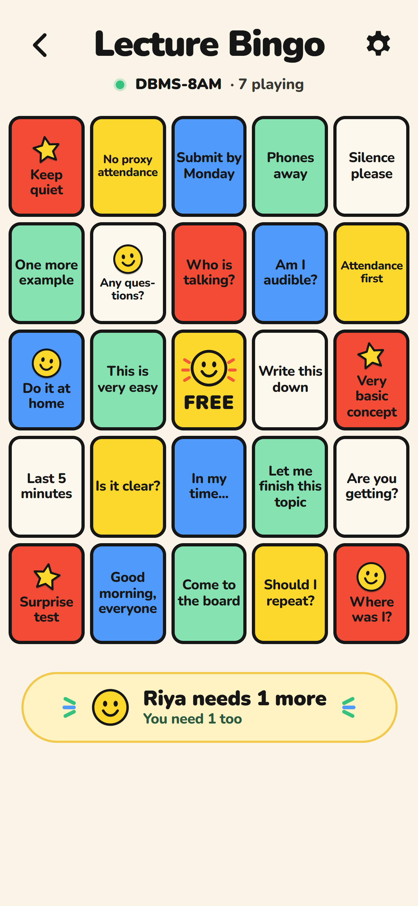
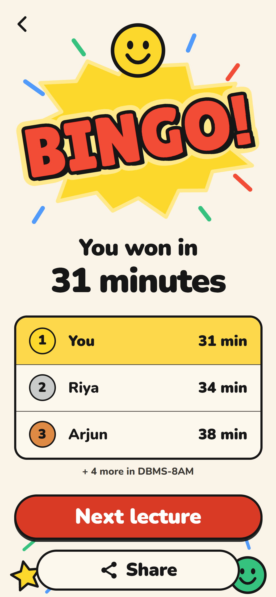

# Lecture Bingo

**Don't sleep through the 8 AM lecture. Play it.** Bingo cards of things professors say in class. One person makes a room with a short code like `DBMS-8AM`, the class joins with the code and a nickname, and everyone gets the same phrases in their own shuffle on a 5x5 card with a FREE centre. Tap a square when your prof says it. First full row, column or diagonal wins, and the whole room sees it happen live.

**Play it:** https://souradip121.github.io/lecture-bingo/
**Or host your own copy for free** in four steps (below). No build step, no server, no paid plan, no sign-up for players.

<p>
  
  
  
</p>

Made by [@souradip.sh](https://www.instagram.com/souradip.sh/).

---

## How to play

1. **Join or start a room.** Type the code your class agreed on (subject + time works: `DBMS-8AM`, `OS-LAB`, `MATHS-2PM`) and press **Join**. If nobody has made it yet, you're offered to start it with the classic card. Pick a nickname.
2. **Share the code** (or the link from the room menu) in your class group.
3. **Tap a square when your prof says it.** A sticker goes on it. Tap again to peel it off if you tapped by mistake.
4. **Watch the strip under your card.** It shows who is closest ("Riya needs 1 more") from the live room.
5. **BINGO.** Five in a row, column or diagonal (the FREE centre counts). Everyone in the room is told who won and in how many minutes, and the round keeps going so others can still finish 2nd, 3rd and so on.
6. **Next lecture** deals everyone a fresh shuffle in the same room. Anyone can press it once the round has a winner; the room's creator can deal new cards any time.

**Make a card for your prof:** the room creator can write the card themselves: 24 to 60 lines, up to 32 characters each. Each lecture deals 24 of them to everyone. Saving changes deals everyone a new card.

The clock starts at the room's first tap, not when the room was made, so "won in 31 minutes" means 31 minutes of lecture. Rooms close 24 hours after they're made; the code is free again after that.

## How a win is checked

Nobody's browser can declare a BINGO. Every tap is a call to `lb_mark`, a Postgres function that:

- checks the player's token, the room, the round and that the cell is on **that player's own card** (0 to 24, not the FREE centre);
- stores the mark in the database (`lb_cards.mask`, one bit per square);
- works out, from the stored marks, how many squares the player still needs for any of the 12 lines;
- when that reaches 0, records the win time and the place (1st, 2nd…) with an atomic counter on the round, and freezes the card so the winning line stays on it.

There is no "I won" call to fake. The only thing a player can do is tap their own squares, the same as in the app. (Whether your prof actually said it is between you and your conscience.)

## Security model

- **No accounts.** Each browser makes a random 256-bit player token and keeps it in localStorage. The database stores only its SHA-256 hash.
- **Row Level Security** is on for every table and there are no policies: the anon key can't read or write any `lb_` table directly. Everything goes through `SECURITY DEFINER` functions (`lb_peek`, `lb_create_room`, `lb_join`, `lb_state`, `lb_mark`, `lb_next_round`, `lb_set_phrases`, `lb_leave`) with `search_path` pinned. Internal helpers (`lb__*`) can't be called by the browser.
- **What other players see:** nicknames, how many squares each still needs, places and times. Never your card, your token or anyone's id. Only the room's creator gets the phrase list back for editing.
- **Live updates** use Supabase Realtime Broadcast, sent by the database itself after a change (`realtime.send` in `lb__notify`) on a topic named after the room's random id. The browser listens; it never sends. If Realtime is unavailable the page polls instead.
- Only the **anon key** is in `config.js`. It's designed to be public; never put the `service_role` key in this repo.
- [`scripts/live-check.mjs`](scripts/live-check.mjs) runs 52 checks against a real project with only the anon key: direct table reads/writes refused, helpers private, input validation, cards kept apart, server-side BINGO, frozen winning cards, round rules, creator-only edits, and Realtime payloads without tokens or cards.

---

## Host your own copy (free, 4 steps)

You need a free [Supabase](https://supabase.com) account and a GitHub account (or Netlify / Vercel).

1. **Create a Supabase project.** supabase.com → New project. Pick the region closest to your college (Mumbai `ap-south-1` for most of India). Save the database password somewhere; Lecture Bingo never needs it.
2. **Run the schema.** Open **SQL Editor → New query**, paste the whole of [`schema.sql`](schema.sql) and press **Run**. It creates four tables, their security rules and the game functions, all prefixed `lb_`. It's safe to run again, and safe in a project that already has other tables. If you turn on the `pg_cron` extension first (**Database → Extensions**), it also schedules an hourly job that deletes rooms older than 24 hours; without it, expired rooms are hidden and get cleared out as new rooms are made.
3. **Put your keys in `config.js`.** Fork this repo and edit [`config.js`](config.js): set `SUPABASE_URL` and `SUPABASE_ANON_KEY` from **Project Settings → API** (Project URL, and the `anon` `public` key). That's the only file you edit. No auth settings to change: players never sign in.
4. **Publish the site.**
   - **GitHub Pages:** in your fork, **Settings → Pages → Build and deployment → Deploy from a branch → `main` / `(root)`**. Your site appears at `https://<you>.github.io/lecture-bingo/`.
   - **Netlify / Vercel:** import the repo. There is no build command; the publish directory is the repo root.

Open your site in two browsers (or a phone and a laptop), make a room in one and join it from the other.

To check your project's security from your computer: `node scripts/live-check.mjs` (Node 22+). It makes rooms whose codes start with `LC-`; delete them afterwards with `delete from public.lb_rooms where code like 'LC-%';`.

### Free-tier notes

- **Projects pause after about a week with no activity.** A paused project can't load rooms. Open your Supabase dashboard and press **Restore project** (a minute or two). Make a test room the night before a big lecture.
- **Realtime:** the free plan allows 200 concurrent connections and 2 million messages a month. Each phone holds one connection while it's on the card. Broadcasts go out only when something changes for the room (a join, someone getting closer to a line, a BINGO, a new round), not on every tap.
- **Size:** a room with 60 players uses a few kilobytes, and rooms delete themselves after 24 hours.

## Files

```
index.html            the whole app (join, card, win, card editor)
config.js             your Supabase URL + anon key (the only file you edit)
schema.sql            tables, RLS, game functions (all lb_*)
assets/css/           styles
assets/js/app.js      screens and taps
assets/js/api.js      calls to the lb_* functions
assets/js/live.js     Realtime Broadcast listener + polling fallback
assets/js/lines.js    the 12 bingo lines (same as lb__lines() in schema.sql)
assets/js/phrases.js  the classic card: 40 things profs say
assets/js/share.js    draws the result card you can share
assets/js/art.js      stickers and icons (inline SVG)
assets/fonts/         Nunito and Lilita One (SIL OFL)
scripts/live-check.mjs  security and game checks against your project
tests/                unit tests for the line maths (npm test)
```

Plain HTML, CSS and JavaScript modules. No build step and nothing to install. To run it locally: `python -m http.server 8000` in the repo folder, then open http://localhost:8000.

## Licence

MIT. Fonts are SIL OFL 1.1 ([Nunito](assets/fonts/OFL-Nunito.txt), [Lilita One](assets/fonts/OFL-Lilita-One.txt)).
